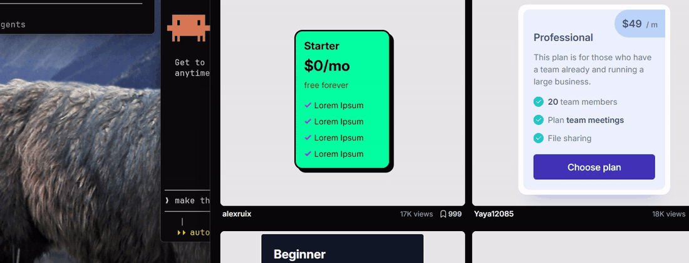
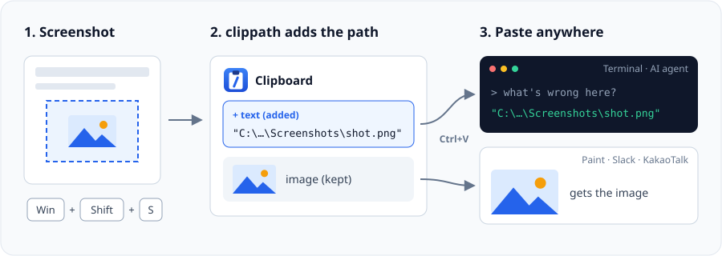
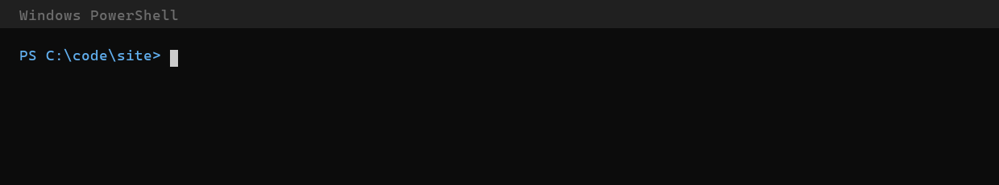

# clippath

**한 번 캡처하고, 필요한 곳에 붙여넣으세요.**

[English](README.md)

Windows 클립보드에 있는 이미지를 PNG 파일로 만들고 그 경로를 클립보드에 넣습니다.
그래서 Windows나 WSL의 터미널 AI 에이전트(Claude Code, Codex 등)에 스크린샷을 바로
붙여넣을 수 있습니다. 이미지도 클립보드에 그대로 남아 있어서, 그림판이나 메신저에
붙여넣으면 이미지가 붙습니다. Python 표준 라이브러리만 씁니다.





## 설치

권장 (`clippath` 명령이 PATH에 자동으로 잡힙니다):

```powershell
uv tool install git+https://github.com/NaNIsaac/clippath
uv tool update-shell  # 처음 한 번만, 그다음 터미널을 새로 여세요
```

uv가 없다면: `powershell -c "irm https://astral.sh/uv/install.ps1 | iex"`
(`pipx install git+https://github.com/NaNIsaac/clippath` + `pipx ensurepath`도 됩니다.)

pip를 쓸 경우:

```powershell
pip install git+https://github.com/NaNIsaac/clippath
```

pip가 `clippath.exe is installed in '...\Scripts' which is not on PATH` 경고를 띄우면
그 폴더를 사용자 PATH에 한 번 추가하고 터미널을 새로 여세요:

```powershell
$d = python -c "import sysconfig; print(sysconfig.get_path('scripts'))"
[Environment]::SetEnvironmentVariable("Path", [Environment]::GetEnvironmentVariable("Path","User") + ";$d", "User")
```

PATH를 건드리고 싶지 않다면 이렇게 실행해도 됩니다:

```powershell
python -m clippath copy
```

## 사용법

한 번만 실행하세요:

```powershell
clippath start          # 백그라운드 감시 시작, 로그인할 때마다 자동 실행
clippath start --wsl    # 같은 기능, /mnt/c/... 경로로 복사
```

그다음에는 캡처하고(`Win+Shift+S`, PrintScreen, 어떤 도구든) AI 터미널에서 `Ctrl+V`
하면 됩니다:

```text
> 이 레이아웃 뭐가 문제야? "C:\Users\me\Pictures\Screenshots\스크린샷 2026-10-16 091500.png"
```

경로는 쌍따옴표로 감싸서 띄어쓰기가 있어도 안전합니다. 경로는 터미널, 코드 에디터,
메모장, 탐색기에만 붙고, 브라우저(ChatGPT 등), 메신저, 그림판에는 이미지만 붙습니다.
일반 텍스트 복사는 건드리지 않습니다.

그냥 경로라서 어떤 명령에든 쓸 수 있습니다:



실행 중에는 트레이에 clippath 아이콘이 보이고(클릭하면 폴더 열기, 종료), 작업관리자에는
`clippath.exe`로 표시됩니다.

## 명령어

| 명령 | 하는 일 |
|---|---|
| `clippath start [--wsl]` | 백그라운드 감시 시작, 로그인할 때마다 자동 실행 |
| `clippath stop` | 감시 종료, 자동 실행 해제 |
| `clippath status` | 감시 상태, 자동 실행 여부, 저장된 파일 정보 |
| `clippath watch [--wsl]` | 터미널 창에서 감시 (Ctrl+C로 종료) |
| `clippath copy [--wsl]` | 지금 클립보드 이미지를 한 번만 변환 |
| `clippath clean [--days N]` | 저장한 스크린샷 삭제 (최근 N일 치는 남김) |

`clippath -h`, `clippath <명령> -h`, `clippath --version`.

## 파일은 어디에 저장되나요

캡처 도구가 이미 파일을 저장했다면(캡처 도구, `Win+PrtScn` → `사진\Screenshots`)
따로 복사본을 만들지 않고 그 파일의 경로를 복사합니다. 이때 파일의 픽셀이 클립보드 이미지와
같은지 먼저 확인합니다. 그 밖의 이미지는
`%LOCALAPPDATA%\clippath\`에 SHA-256 이름으로 저장해서, 같은 이미지는 한 번만 저장합니다.
`clippath clean`은 이 폴더만 지웁니다. 어떤 데이터도 외부로 보내지 않습니다.

## Rust 버전 (작업 중)

Python 없이 `.exe` 하나로 돌아가도록 clippath를 Rust로 옮기고 있습니다. 첫 단계는 끝났습니다.
`clippath copy [--wsl]`은 Python 명령과 똑같이 동작하며, 픽셀이 같은 스크린샷 파일을 재사용하는
것도 같습니다. 백그라운드 감시, 트레이 아이콘, 나머지 명령은 아직 Python 패키지가 맡습니다.

```bash
cargo build --release              # target\release\clippath.exe
target\release\clippath.exe copy
```

`main`에 푸시할 때마다 GitHub Actions에서도 exe를 빌드합니다(아티팩트 `clippath-windows-x64`).
